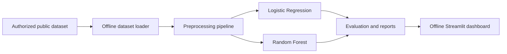

# AI-Based Network Intrusion Detection System Using Machine Learning

[](LICENSE)

> **Status: Phase 3 — reproducible baseline training implemented and verified with synthetic fixtures.** No official UNSW records have been downloaded or trained on, and no performance scores are available. The Streamlit dashboard remains a placeholder.

## Project Overview

This is an **offline, defensive research project** to compare machine-learning approaches for classifying normal and potentially malicious network-flow records from an authorized, public academic dataset. It does not capture traffic, probe hosts, or interact with live networks.

## Research Problem

Network intrusion detection requires distinguishing suspicious activity from ordinary network behavior while controlling false alarms. Class imbalance, leakage, and distribution shifts can make evaluation misleading. The project investigates whether a reproducible feature-processing and classification pipeline can provide meaningful baseline results.

## Objectives

1. Obtain an appropriately licensed academic network-flow dataset through its official source.
2. Apply preprocessing **within training-only fitted pipelines**.
3. Train and compare Logistic Regression and Random Forest baselines.
4. Report precision, recall, F1-score, confusion matrices, and ROC-AUC when suitable.
5. Provide an offline Streamlit dashboard for reviewing real evaluation outputs.
6. Document experimental setup, limitations, and reproducible commands.

## Dataset and Methodology

**Dataset chosen:** UNSW-NB15. Its [official research page](https://research.unsw.edu.au/projects/unsw-nb15-dataset) grants academic-research use, retains the authors' copyright, requires citations to five papers, and states that commercial use needs author agreement. The data are **not bundled, mirrored, or MIT licensed**. Instructions and attribution: [docs/dataset.md](docs/dataset.md).

Implemented in Phase 2: offline reading and schema validation of the provider-named CSVs; stratified training/validation split only within the official training portion; exclusion of `id`, `attack_cat`, and `label`; and an **unfitted** `ColumnTransformer` for numeric median imputation/scaling and categorical mode imputation/one-hot encoding. **Phase 3 now fits it independently in each training-only model pipeline.** No official files have been processed yet. The held-out official test partition is not used for training or model selection.

## System Architecture



| Component | Planned responsibility | Phase |
| --- | --- | --- |
| `src/nids/data/` | Dataset import and validation | **2 — implemented** |
| `src/nids/features/` | Leakage-safe preprocessing | **2 — implemented** |
| `src/nids/models/train.py` | Reproducible Logistic Regression and Random Forest baselines | **3 — implemented** |
| `src/nids/models/evaluate.py` | Held-out evaluation and metrics | 4 |
| `src/nids/visualization/` | Confusion matrix / ROC figures | 4 |
| `app/streamlit_app.py` | Offline results dashboard | 5 |
| `tests/` and `.github/workflows/` | Local and CI checks | 1, 6 |

Read [docs/architecture.md](docs/architecture.md) for design details and file contracts.

## Installation Instructions

Use Python 3.11 or 3.12 in a virtual environment. The scaffold status command requires only the Python standard library; full package installation is for later phases.

```bash
python -m venv .venv
# Linux/macOS:
source .venv/bin/activate
# Windows PowerShell:
# .venv\Scripts\Activate.ps1
python -m pip install -r requirements-dev.txt
nids status
# Download the two provider-named CSVs separately to data/raw/ before inspecting:
nids inspect-data --data-dir data/raw
# Only when you have the official CSVs downloaded locally:
nids train --data-dir data/raw --output-dir artifacts/models --seed 42 --trees 100
pytest -q
```

Without installing dependencies, you can inspect the project state from the repository root:

```bash
PYTHONPATH=src python -m nids.cli status      # Linux/macOS
# PowerShell: $env:PYTHONPATH='src'; python -m nids.cli status
```

The `status` command reports whether *local* dataset/model/result files exist. `inspect-data` prints aggregate counts only. The `train` command (requiring official local CSVs) fits both baselines and saves them under ignored `artifacts/models/` without evaluating test performance. See [training instructions](docs/training.md).

When implemented in Phase 5, the dashboard will start using:

```bash
streamlit run app/streamlit_app.py
```

## Model Evaluation

**Not run on official data yet.** Phase 3 fits the pipelines only; predictive metrics are not calculated. Predefined reporting will include class-wise precision/recall/F1, confusion matrix, ROC-AUC if scores and labels are appropriate, and a false-positive rate with clear denominators. The untouched test partition will not be used for model selection. See [experiment protocol](docs/experiment_log.md).

## Results and Limitations

**No numerical model results are available at Phase 3.** The repository provides offline dataset loading, preprocessing and two classifier training pipelines tested only on synthetic fixtures, not an operational detection system. UNSW permits academic research under attribution conditions; actual row distributions and predictive performance await authorized local-data inspection and experimentation. Training on a static academic dataset will not demonstrate reliable real-world generalization or suitability for deployment.

## Future Improvements

- Obtain official data locally under UNSW academic-use terms and inspect source distributions (Phase 2 file validation).
- Run the implemented reproducible baseline training on permitted official local data and record manifest hashes (Phase 3 operational run).
- Evaluate on held-out records and analyze false positives (Phase 4).
- Build a read-only, offline reporting interface (Phase 5).
- Add substantive preprocessing/training/evaluation tests and CI quality checks (Phase 6).
- Complete an evidence-based research report with **measured** results (Phase 7).

## References

- UNSW Sydney, [UNSW-NB15 dataset and provider citation requirements](https://research.unsw.edu.au/projects/unsw-nb15-dataset) (academic-use permission with copyright and mandatory references; see `docs/dataset.md`).
- Pedregosa et al. (2011), [Scikit-learn: Machine Learning in Python](https://www.jmlr.org/papers/v12/pedregosa11a.html), *Journal of Machine Learning Research*, 12, 2825–2830.
- scikit-learn developers, [Pipelines and composite estimators](https://scikit-learn.org/stable/modules/compose.html).
- Streamlit, [Official documentation](https://docs.streamlit.io/).

## Responsible Use

All inputs must be public/authorized, non-sensitive, and used under applicable permissions. Do not upload real network traffic, private records, credentials, or model outputs derived from confidential data. This is an academic prototype, not a security guarantee.

## License

The **project source code** is MIT licensed. The dataset, if used, remains governed by the dataset provider's own terms.
