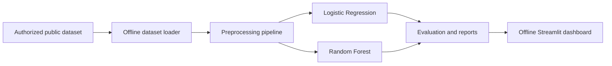

# AI-Based Network Intrusion Detection System Using Machine Learning

[](LICENSE)

> **Status: Phase 5 — offline read-only Streamlit dashboard implemented.** Tests use synthetic fixtures only. We have not downloaded or evaluated official UNSW records, so there are **no reportable research results yet**. The dashboard shows an honest empty state until local aggregate results exist.

## Project Overview

This is an **offline, defensive research project** to compare machine-learning approaches for classifying normal and potentially malicious network-flow records from an authorized, public academic dataset. It does not capture traffic, probe hosts, or interact with live networks.

## Research Problem

Network intrusion detection requires distinguishing suspicious activity from ordinary network behavior while controlling false alarms. Class imbalance, leakage, and distribution shifts can make evaluation misleading. The project investigates whether a reproducible feature-processing and classification pipeline can provide meaningful baseline results.

## Objectives

1. Obtain an appropriately licensed academic network-flow dataset through its official source.
2. Apply preprocessing **within training-only fitted pipelines**.
3. Train and compare Logistic Regression and Random Forest baselines.
4. Report precision, recall, F1-score, confusion matrices, and ROC-AUC when suitable.
5. Provide an offline Streamlit dashboard for reviewing real evaluation outputs.
6. Document experimental setup, limitations, and reproducible commands.

## Dataset and Methodology

**Dataset chosen:** UNSW-NB15. Its [official research page](https://research.unsw.edu.au/projects/unsw-nb15-dataset) grants academic-research use, retains the authors' copyright, requires citations to five papers, and states that commercial use needs author agreement. The data are **not bundled, mirrored, or MIT licensed**. Instructions and attribution: [docs/dataset.md](docs/dataset.md).

Implemented in Phase 2: offline reading and schema validation of the provider-named CSVs; stratified training/validation split only within the official training portion; exclusion of `id`, `attack_cat`, and `label`; and an **unfitted** `ColumnTransformer` for numeric median imputation/scaling and categorical mode imputation/one-hot encoding. **Phase 3 now fits it independently in each training-only model pipeline.** No official files have been processed yet. The held-out official test partition is not used for training or model selection.

## System Architecture



| Component | Planned responsibility | Phase |
| --- | --- | --- |
| `src/nids/data/` | Dataset import and validation | **2 — implemented** |
| `src/nids/features/` | Leakage-safe preprocessing | **2 — implemented** |
| `src/nids/models/train.py` | Reproducible Logistic Regression and Random Forest baselines | **3 — implemented** |
| `src/nids/models/evaluate.py` | Select by validation F1; held-out metrics and false alarms | **4 — implemented** |
| `src/nids/visualization/` | Confusion matrix / ROC figures | 4 |
| `src/nids/dashboard.py` | Validate aggregate JSON before display | **5 — implemented** |
| `app/streamlit_app.py` | Offline results dashboard | **5 — implemented** |
| `tests/` and `.github/workflows/` | Local and CI checks | 1, 6 |

Read [docs/architecture.md](docs/architecture.md) for design details and file contracts.

## Installation Instructions

Use Python 3.11 or 3.12 in a virtual environment. The scaffold status command requires only the Python standard library; full package installation is for later phases.

```bash
python -m venv .venv
# Linux/macOS:
source .venv/bin/activate
# Windows PowerShell:
# .venv\Scripts\Activate.ps1
python -m pip install -r requirements-dev.txt
nids status
# Download the two provider-named CSVs separately to data/raw/ before inspecting:
nids inspect-data --data-dir data/raw
# Only when you have the official CSVs downloaded locally:
nids train --data-dir data/raw --output-dir artifacts/models --seed 42 --trees 100
nids evaluate --data-dir data/raw --output-dir artifacts/reports --seed 42 --trees 100
pytest -q
```

Without installing dependencies, you can inspect the project state from the repository root:

```bash
PYTHONPATH=src python -m nids.cli status      # Linux/macOS
# PowerShell: $env:PYTHONPATH='src'; python -m nids.cli status
```

The `status` command reports whether *local* dataset/model/result files exist. `inspect-data` prints aggregate counts only. `train` fits and saves two baselines under ignored `artifacts/models/` without evaluating test performance. `evaluate` **refits from the supplied CSVs** (it does not deserialize or reuse saved joblib), selects on validation F1, and evaluates **only the selected model** on the held-out test set, saving aggregate JSON and plots under ignored `artifacts/reports/`. See [training instructions](docs/training.md) and [evaluation protocol](docs/evaluation.md).

The Phase 5 dashboard is implemented. Start it locally using:

```bash
streamlit run app/streamlit_app.py
```

The app reads `artifacts/reports/evaluation.json` locally, displays **only aggregate** validation/test metrics, offers a validation model-comparison chart and a held-out confusion matrix, and warns that CSV provenance is not established by file names or checksums. It never loads joblib/pickle objects, raw flow rows, or live network packets. Missing evaluation files produce setup instructions, **not fake model scores**. See [dashboard guide](docs/dashboard.md). Optional local override: `NIDS_REPORT_DIR`.

## Model Evaluation

**Implemented, not run on official data.** Phase 4 computes validation metrics for both baselines and selects a winner using *positive-class validation F1*. Only this preselected model is scored against the held-out provider testing split. Reported fields include class-wise precision/recall/F1, class support, 2×2 confusion matrix, false-positive rate `FP/(TN+FP)`, false-negative rate, macro/weighted F1, and ROC-AUC (set to `null` with an explanation if the true labels contain one class). Output PNGs contain only aggregate figures. See [evaluation protocol](docs/evaluation.md).

## Results and Limitations

**No numerical model results on real UNSW data are available at Phase 5.** Synthetic unit tests exercise the metrics and end-to-end evaluation pipeline, but their outputs are *not scientific benchmark scores*. The repository is not an operational detection system. UNSW permits academic research under attribution conditions; actual row distributions and predictive performance await authorized local-data inspection and experimentation. Training on a static academic dataset will not demonstrate reliable real-world generalization or suitability for deployment.

## Future Improvements

- Obtain official data locally under UNSW academic-use terms and inspect source distributions (Phase 2 file validation).
- Run the implemented reproducible baseline training on permitted official local data and record manifest hashes (Phase 3 operational run).
- Run Phase 4 evaluation on authorized, verified official CSVs exactly once after model selection; add its actual measurements to the report.
- Run the implemented offline dashboard on results from authorized, independently verified academic data (Phase 5 implemented; real-data run pending).
- Add substantive preprocessing/training/evaluation tests and CI quality checks (Phase 6).
- Complete an evidence-based research report with **measured** results (Phase 7).

## References

- UNSW Sydney, [UNSW-NB15 dataset and provider citation requirements](https://research.unsw.edu.au/projects/unsw-nb15-dataset) (academic-use permission with copyright and mandatory references; see `docs/dataset.md`).
- Pedregosa et al. (2011), [Scikit-learn: Machine Learning in Python](https://www.jmlr.org/papers/v12/pedregosa11a.html), *Journal of Machine Learning Research*, 12, 2825–2830.
- scikit-learn developers, [Pipelines and composite estimators](https://scikit-learn.org/stable/modules/compose.html).
- Streamlit, [Official documentation](https://docs.streamlit.io/).

## Responsible Use

All inputs must be public/authorized, non-sensitive, and used under applicable permissions. Do not upload real network traffic, private records, credentials, or model outputs derived from confidential data. This is an academic prototype, not a security guarantee.

## License

The **project source code** is MIT licensed. The dataset, if used, remains governed by the dataset provider's own terms.
