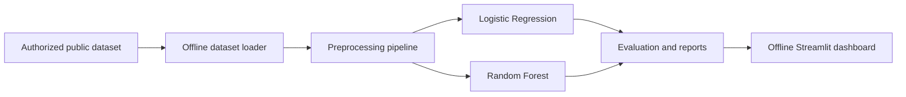

# AI-Based Network Intrusion Detection System Using Machine Learning

[](LICENSE)

> **Status: seven implementation stages complete, plus one local empirical run on user-supplied UNSW-NB15-layout data.** Random Forest was selected by validation attack F1; it achieved **91.91% attack F1** and **17.35% false-positive rate** on the supplied held-out test file. **Dataset-byte authenticity was not independently verified.** Predictor-vector duplicates across splits raise possible optimism; this is not a deployment-ready IDS. Original CSVs and models are excluded from GitHub.

**Researcher:** Abdulkarim Mohsen Hussein Alhuos  
**Affiliation:** College of Engineering and Information Technology, Amran University  
**Field:** Cybersecurity and Networks

## Project Overview

This is an **offline, defensive research project** to compare machine-learning approaches for classifying normal and potentially malicious network-flow records from an authorized, public academic dataset. It does not capture traffic, probe hosts, or interact with live networks.

## Research Problem

Network intrusion detection requires distinguishing suspicious activity from ordinary network behavior while controlling false alarms. Class imbalance, leakage, and distribution shifts can make evaluation misleading. The project investigates whether a reproducible feature-processing and classification pipeline can provide meaningful baseline results.

## Objectives

1. Obtain an appropriately licensed academic network-flow dataset through its official source.
2. Apply preprocessing **within training-only fitted pipelines**.
3. Train and compare Logistic Regression and Random Forest baselines.
4. Report precision, recall, F1-score, confusion matrices, and ROC-AUC when suitable.
5. Provide an offline Streamlit dashboard for reviewing real evaluation outputs.
6. Document experimental setup, limitations, and reproducible commands.

## Dataset and Methodology

**Dataset chosen:** UNSW-NB15. Its [official research page](https://research.unsw.edu.au/projects/unsw-nb15-dataset) grants academic-research use, retains the authors' copyright, requires citations to five papers, and states that commercial use needs author agreement. The data are **not bundled, mirrored, or MIT licensed**. Instructions and attribution: [docs/dataset.md](docs/dataset.md).

Implemented in Phase 2: offline reading and schema validation of the provider-named CSVs; stratified training/validation split only within the official training portion; exclusion of `id`, `attack_cat`, and `label`; and an **unfitted** `ColumnTransformer` for numeric median imputation/scaling and categorical mode imputation/one-hot encoding. **Phase 3 now fits it independently in each training-only model pipeline.** User-provided UNSW-NB15-layout files were processed for a single local empirical benchmark; source authenticity was not independently established. The held-out official test partition is not used for training or model selection.

## System Architecture



| Component | Planned responsibility | Phase |
| --- | --- | --- |
| `src/nids/data/` | Dataset import and validation | **2 — implemented** |
| `src/nids/features/` | Leakage-safe preprocessing | **2 — implemented** |
| `src/nids/models/train.py` | Reproducible Logistic Regression and Random Forest baselines | **3 — implemented** |
| `src/nids/models/evaluate.py` | Select by validation F1; held-out metrics and false alarms | **4 — implemented** |
| `src/nids/visualization/` | Confusion matrix / ROC figures | 4 |
| `src/nids/dashboard.py` | Validate aggregate JSON before display | **5 — implemented** |
| `app/streamlit_app.py` | Offline results dashboard | **5 — implemented** |
| `tests/`, `scripts/` and `.github/workflows/` | Synthetic tests, tracked-file hygiene, and CI coverage gates | **6 — implemented** |
| `docs/research_report.md` and related academic documents | Research method, findings status, reproducibility and citations | **7 — documented** |

Read [docs/architecture.md](docs/architecture.md) for design details and file contracts.

## Installation Instructions

Use Python 3.11 or 3.12 in a virtual environment. The scaffold status command requires only the Python standard library; full package installation is for later phases.

```bash
python -m venv .venv
# Linux/macOS:
source .venv/bin/activate
# Windows PowerShell:
# .venv\Scripts\Activate.ps1
python -m pip install -r requirements-dev.txt
nids status
# Download the two provider-named CSVs separately to data/raw/ before inspecting:
nids inspect-data --data-dir data/raw
# Only when you have the official CSVs downloaded locally:
nids train --data-dir data/raw --output-dir artifacts/models --seed 42 --trees 100
nids evaluate --data-dir data/raw --output-dir artifacts/reports --seed 42 --trees 100
python scripts/check_repo_hygiene.py --root .
python -m pytest -q --cov=nids --cov=app --cov-report=term-missing:skip-covered --cov-fail-under=90
```

Without installing dependencies, you can inspect the project state from the repository root:

```bash
PYTHONPATH=src python -m nids.cli status      # Linux/macOS
# PowerShell: $env:PYTHONPATH='src'; python -m nids.cli status
```

The `status` command reports whether *local* dataset/model/result files exist. `inspect-data` prints aggregate counts only. `train` fits and saves two baselines under ignored `artifacts/models/` without evaluating test performance. `evaluate` **refits from the supplied CSVs** (it does not deserialize or reuse saved joblib), selects on validation F1, and evaluates **only the selected model** on the held-out test set, saving aggregate JSON and plots under ignored `artifacts/reports/`. See [training instructions](docs/training.md) and [evaluation protocol](docs/evaluation.md).

The Phase 5 dashboard is implemented. Start it locally using:

```bash
streamlit run app/streamlit_app.py
```

The app reads `artifacts/reports/evaluation.json` locally, displays **only aggregate** validation/test metrics, offers a validation model-comparison chart and a held-out confusion matrix, and warns that CSV provenance is not established by file names or checksums. It never loads joblib/pickle objects, raw flow rows, or live network packets. Missing evaluation files produce setup instructions, **not fake model scores**. See [dashboard guide](docs/dashboard.md). Optional local override: `NIDS_REPORT_DIR`.

## Testing and Quality

Phase 6 runs source compilation, a basic CLI smoke test, pytest with a **90% minimum coverage gate**, and a Git-index check that rejects mistakenly staged research datasets, model artifacts and common credential filenames. GitHub Actions checks Python 3.11 and 3.12; Dependabot proposes weekly dependency updates for review. See [quality assurance](docs/quality_assurance.md) and [security policy](SECURITY.md). These checks are **not** evidence of real-world network detection performance.

## Model Evaluation

**Implemented and executed once on the user-supplied dataset.** Phase 4 computes validation metrics for both baselines and selects a winner using *positive-class validation F1*. Only this preselected model is scored against the held-out provider testing split. Reported fields include class-wise precision/recall/F1, class support, 2×2 confusion matrix, false-positive rate `FP/(TN+FP)`, false-negative rate, macro/weighted F1, and ROC-AUC (set to `null` with an explanation if the true labels contain one class). Output PNGs contain only aggregate figures. See [evaluation protocol](docs/evaluation.md).

## Results and Limitations

**One measured local benchmark** was completed on user-supplied CSVs named for the UNSW-NB15 train/test partitions. The files matched the documented row counts and 45-column schema but were **not independently authenticated** against provider-distributed bytes. Only the selected model was scored on held-out test data.

| Metric (validation only) | Logistic Regression | Random Forest |
| --- | ---: | ---: |
| Accuracy | 93.24% | 94.92% |
| ROC-AUC | 98.44% | 99.28% |
| False-positive rate | 10.65% | 4.98% |
| Attack precision | 95.01% | 97.60% |
| Attack recall | 95.06% | 94.88% |
| Attack F1 | 95.03% | 96.22% |

**Selected model:** Random Forest, by validation attack F1. **Held-out test (82,332 rows):** accuracy **90.59%**, attack precision **87.27%**, attack recall **97.07%**, attack F1 **91.91%**, ROC-AUC **98.46%**, and FPR **17.35%** (6,419 false alarms among 37,000 normal records). Confusion matrix: TN=30,581, FP=6,419, FN=1,328, TP=44,004.

**Critical caveat:** 8,054 test records and 16,342 validation records match predictor-vector fingerprints in the fitting subset. This indicates non-independent feature patterns and possible optimistic benchmark performance. No retuning was performed after looking at the final test scores. A static research dataset cannot establish live network reliability.

- [Complete empirical research report](docs/research_report.md)
- [Measured aggregate JSON](docs/results/evaluation.json) (no raw rows)
- [Validated result summary](docs/results/benchmark_summary.md)
- [Post-hoc overlap audit](docs/results/dataset_overlap_audit.json)
- [Data-access and reproduction instructions](docs/benchmark_execution.md)

## Future Improvements

- Independently verify the CSV bytes against the provider's official data and cite all five required publications.
- Pre-register and perform a **new** leakage-resistant, source-aware deduplicated experiment; do not retune using the current held-out test and call it an unbiased first test.
- Replicate on additional datasets or separated recording sessions; assess model calibration and alert-volume costs.
- Improve operational relevance while keeping the prototype offline, defensive and privacy-preserving.
- Maintain Python 3.11/3.12 CI coverage and dependencies; record the Python 3.13.5 experiment environment separately.

## Academic Documentation (Phase 7 + empirical follow-up)

The research software, citations, and empirical manuscript are available. Scientific statements are limited to the measured local run, with documented source-provenance and predictor-duplication limitations. The README and portfolio describe a research prototype, **not a certified or published IDS**.

- [Research report](docs/research_report.md)
- [Reproducibility guide](docs/reproducibility.md)
- [Verified reference bibliography](docs/references.md)
- [Model card](docs/model_card.md)
- [Recorded measured results](docs/results_reporting_template.md)
- [Academic portfolio summary](docs/academic_portfolio.md)


## References

See the [curated academic bibliography](docs/references.md) and the [official UNSW-NB15 dataset source](https://research.unsw.edu.au/projects/unsw-nb15-dataset). For research using the dataset, the provider requires five specific academic papers—not only the first original-dataset paper. GitHub's **Cite this repository** control uses [CITATION.cff](CITATION.cff); dataset citations remain an additional requirement.

## Responsible Use

All inputs must be public/authorized, non-sensitive, and used under applicable permissions. Do not upload real network traffic, private records, credentials, or model outputs derived from confidential data. This is an academic prototype, not a security guarantee.

## License

The **project source code** is MIT licensed. The dataset, if used, remains governed by the dataset provider's own terms.
