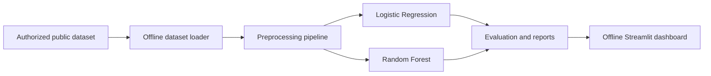

# AI-Based Network Intrusion Detection System Using Machine Learning

[](LICENSE)

> **Status: Phase 1 — architecture and project scaffolding.** This repository does **not** yet contain a trained intrusion-detection model, experiment results, or a usable classification dashboard. All experiment findings will be reported only after verified execution.

## Project Overview

This is an **offline, defensive research project** to compare machine-learning approaches for classifying normal and potentially malicious network-flow records from an authorized, public academic dataset. It does not capture traffic, probe hosts, or interact with live networks.

## Research Problem

Network intrusion detection requires distinguishing suspicious activity from ordinary network behavior while controlling false alarms. Class imbalance, leakage, and distribution shifts can make evaluation misleading. The project investigates whether a reproducible feature-processing and classification pipeline can provide meaningful baseline results.

## Objectives

1. Obtain an appropriately licensed academic network-flow dataset through its official source.
2. Apply preprocessing **within training-only fitted pipelines**.
3. Train and compare Logistic Regression and Random Forest baselines.
4. Report precision, recall, F1-score, confusion matrices, and ROC-AUC when suitable.
5. Provide an offline Streamlit dashboard for reviewing real evaluation outputs.
6. Document experimental setup, limitations, and reproducible commands.

## Dataset and Methodology

**Planned dataset:** UNSW-NB15, subject to verifying download conditions, usage permissions, schema, and official train/test partition before Phase 2. See the [UNSW Research dataset page](https://research.unsw.edu.au/projects/unsw-nb15-dataset). The dataset is **not bundled or mirrored** in this project; the project's MIT license applies to the code, **not** to third-party datasets.

Proposed experiment: use an explicit held-out test partition; split the training portion for model selection; fit imputers, categorical encoders, and scalers on training folds only using scikit-learn `Pipeline` and `ColumnTransformer`; record fixed random seeds and installed package versions. Confirm that label-derived fields and identifier columns cannot leak target information. This is a proposed protocol, **not a completed experiment**.

## System Architecture



| Component | Planned responsibility | Phase |
| --- | --- | --- |
| `src/nids/data/` | Dataset import and validation | 2 |
| `src/nids/features/` | Leakage-safe preprocessing | 2 |
| `src/nids/models/train.py` | Reproducible model training | 3 |
| `src/nids/models/evaluate.py` | Held-out evaluation and metrics | 4 |
| `src/nids/visualization/` | Confusion matrix / ROC figures | 4 |
| `app/streamlit_app.py` | Offline results dashboard | 5 |
| `tests/` and `.github/workflows/` | Local and CI checks | 1, 6 |

Read [docs/architecture.md](docs/architecture.md) for design details and file contracts.

## Installation Instructions

Use Python 3.11 or 3.12 in a virtual environment. The scaffold status command requires only the Python standard library; full package installation is for later phases.

```bash
python -m venv .venv
# Linux/macOS:
source .venv/bin/activate
# Windows PowerShell:
# .venv\Scripts\Activate.ps1
python -m pip install -r requirements-dev.txt
nids status
pytest -q
```

Without installing dependencies, you can inspect the project state from the repository root:

```bash
PYTHONPATH=src python -m nids.cli status      # Linux/macOS
# PowerShell: $env:PYTHONPATH='src'; python -m nids.cli status
```

The command reports whether *local* dataset/model/result files exist. It does not evaluate network security.

When implemented in Phase 5, the dashboard will start using:

```bash
streamlit run app/streamlit_app.py
```

## Model Evaluation

**Not run yet.** Predefined reporting will include class-wise precision/recall/F1, confusion matrix, ROC-AUC if scores and labels are appropriate, and a false-positive rate with clear denominators. The untouched test partition will not be used for model selection. See [experiment protocol](docs/experiment_log.md).

## Results and Limitations

**No numerical model results are available at Phase 1.** The current repository provides a tested project skeleton and a basic status command, not an operational detection system. Dataset licensing, label distributions, and predictive performance require verification and experimental execution. Training on a static academic dataset will not demonstrate reliable real-world generalization or suitability for deployment.

## Future Improvements

- Verify official data access and study label definitions (Phase 2).
- Add reproducible baseline training and artifact metadata (Phase 3).
- Evaluate on held-out records and analyze false positives (Phase 4).
- Build a read-only, offline reporting interface (Phase 5).
- Add substantive preprocessing/training/evaluation tests and CI quality checks (Phase 6).
- Complete an evidence-based research report with **measured** results (Phase 7).

## References

- UNSW Sydney, [UNSW-NB15 dataset](https://research.unsw.edu.au/projects/unsw-nb15-dataset) (official research-project page; license/terms to be checked before use).
- Pedregosa et al. (2011), [Scikit-learn: Machine Learning in Python](https://www.jmlr.org/papers/v12/pedregosa11a.html), *Journal of Machine Learning Research*, 12, 2825–2830.
- scikit-learn developers, [Pipelines and composite estimators](https://scikit-learn.org/stable/modules/compose.html).
- Streamlit, [Official documentation](https://docs.streamlit.io/).

## Responsible Use

All inputs must be public/authorized, non-sensitive, and used under applicable permissions. Do not upload real network traffic, private records, credentials, or model outputs derived from confidential data. This is an academic prototype, not a security guarantee.

## License

The **project source code** is MIT licensed. The dataset, if used, remains governed by the dataset provider's own terms.
